# Workshop 4 : Sécurisation des images Docker avec Trivy

**Nom et Prénom :** Nhaila Soukina  
**Branche Git :** `workshop4-Groupe10`  
**Projet :** FocusBoard : mini application web Flask avec SQLite  
**Outil de sécurité :** Trivy  
**CI/CD :** GitHub Actions

---

## 1. Objectif du workshop

L'objectif de ce workshop est de sécuriser une image Docker à l'aide de **Trivy**. Le travail consiste à :

- Analyser une image Docker pour détecter les vulnérabilités (CVE).
- Identifier les mauvaises configurations et les secrets potentiellement exposés.
- Interpréter les résultats en donnant la priorité aux vulnérabilités HIGH et CRITICAL.
- Appliquer des mesures de remédiation pour renforcer l'image Docker.
- Intégrer Trivy dans un pipeline CI/CD avec un seuil de blocage basé sur la sévérité.

## 2. Préparation du projet

Le projet utilisé est **FocusBoard**, une petite application web développée avec Python Flask et SQLite.

### Création et utilisation de la branche Git

Une branche dédiée au workshop a été créée conformément aux consignes :

```powershell
git checkout -b workshop4-Groupe10
```

Le dépôt GitHub utilisé :

[https://github.com/soukina-nhaila/workshop4-Groupe10](https://github.com/soukina-nhaila/workshop4-Groupe10)

### Vérification initiale du projet

Avant la sécurisation, l'application a été lancée dans un conteneur Docker afin de vérifier son fonctionnement.

Construction de l'image initiale :

```powershell
docker build -t workshop4-web:before .
```


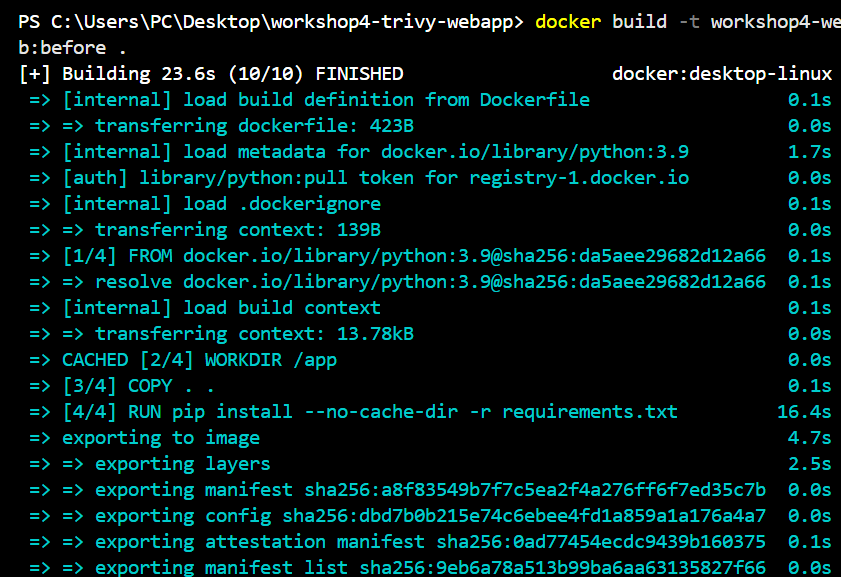


L'application était accessible à l'adresse :

`http://localhost:5000` 

Lancer l'application utilisant la commande :
```
docker run --rm --name workshop4-web -p 5000:5000 workshop4-web:before
```

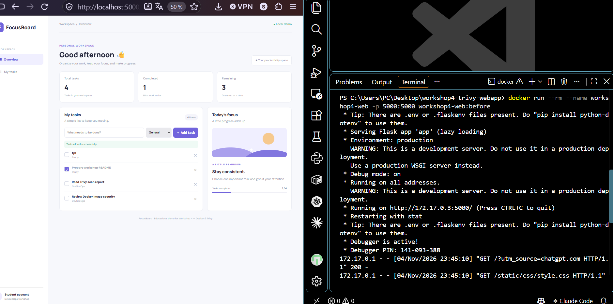

## 3. Analyse de l'image initiale avec Trivy

### 3.1 Scan des vulnérabilités

La première image a été analysée avec Trivy :

```powershell
docker run --rm -v /var/run/docker.sock:/var/run/docker.sock aquasec/trivy:latest image workshop4-web:before
```

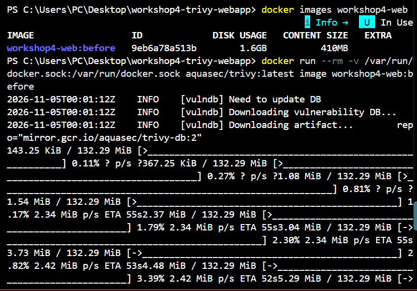

Pour afficher uniquement les vulnérabilités HIGH et CRITICAL :

```powershell
docker run --rm -v /var/run/docker.sock:/var/run/docker.sock aquasec/trivy:latest image --severity HIGH,CRITICAL workshop4-web:before
```

### 3.2 Interprétation des résultats initiaux

Le scan a révélé plusieurs vulnérabilités dans les paquets du système Debian et les dépendances Python.

| Composant analysé | Résultats initiaux |
|---|---:|
| Paquets Debian | 2 397 HIGH et 235 CRITICAL |
| Dépendances Python | 13 HIGH |
| Dépendances Python CRITICAL | 0 |

Les principales dépendances Python concernées comprenaient notamment Flask, Werkzeug et urllib3 dans leurs anciennes versions.

Ces résultats montrent l'importance de maintenir à jour l'image de base et les dépendances de l'application.

**Note :** le nombre de vulnérabilités des paquets système peut inclure plusieurs détections associées à un même CVE sur différents paquets.

### 3.3 Scan des mauvaises configurations

Le Dockerfile initial a également été analysé :

```powershell
docker run --rm -v "${PWD}:/project" aquasec/trivy:latest config /project
```
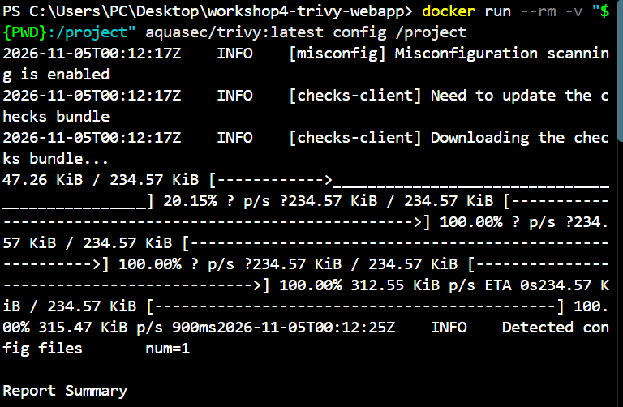
Trois mauvaises configurations ont été identifiées :

| Règle Trivy | Sévérité | Problème identifié |
|---|---|---|
| DS-0002 | HIGH | Absence d'un utilisateur non-root |
| DS-0026 | LOW | Absence de HEALTHCHECK |
| DS-0031 | CRITICAL | Risque d'exposition d'une clé via une instruction ENV |

Ces problèmes indiquaient que le conteneur nécessitait un renforcement de sa configuration.

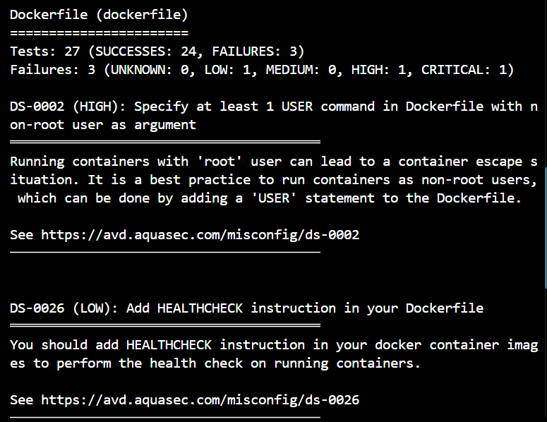

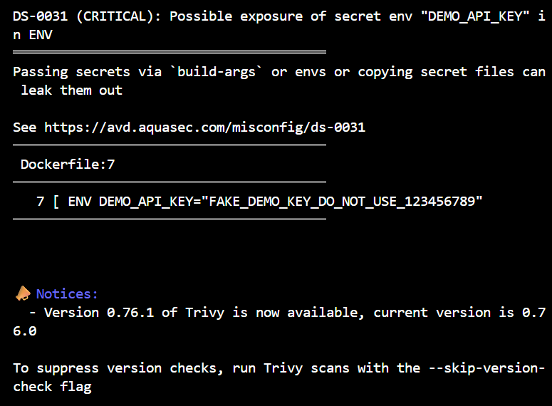

### 3.4 Analyse des secrets

Un scan des fichiers du projet a été réalisé pour rechercher d'éventuels secrets exposés :

```powershell
docker run --rm -v "${PWD}:/project" aquasec/trivy:latest fs --scanners secret /project
```

Le projet d'entraînement contenait des valeurs fictives destinées à tester la gestion des secrets. Ces valeurs ne doivent pas être utilisées comme de véritables identifiants.

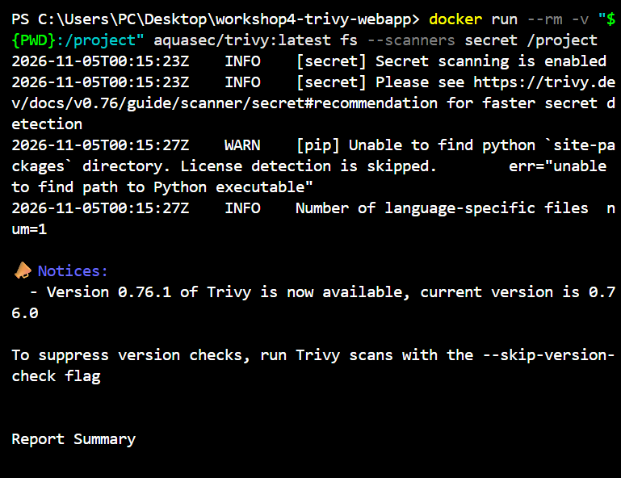

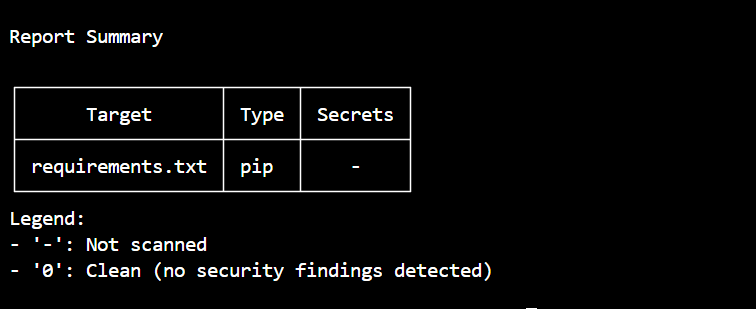

## 4. Remédiation et sécurisation

Après l'analyse initiale, plusieurs modifications ont été appliquées.

### 4.1 Mise à jour de l'image Docker

L'image de base a été remplacée :

```dockerfile
FROM python:3.13-slim
```

Les paquets du système ont été mis à jour pendant la construction :

```dockerfile
RUN apt-get update \
    && apt-get upgrade -y --no-install-recommends \
    && rm -rf /var/lib/apt/lists/*
```

### 4.2 Mise à jour des dépendances Python

Le fichier `requirements.txt` a été simplifié et mis à jour :

```text
Flask==3.1.3
```

Les anciennes dépendances inutilisées, notamment les versions directes de `requests` et `urllib3`, ont été supprimées après vérification de leur absence d'utilisation dans le code de l'application.

Pip a également été désinstallé après l'installation des dépendances afin de ne pas conserver cet outil dans l'image d'exécution :

```dockerfile
RUN pip install --no-cache-dir -r requirements.txt \
    && pip uninstall -y pip
```

### 4.3 Exécution avec un utilisateur non-root

Un utilisateur dédié a été créé pour éviter l'exécution de l'application en tant que root :

```dockerfile
RUN useradd --create-home --shell /usr/sbin/nologin appuser
```

Les permissions du répertoire de l'application ont été adaptées, puis l'utilisateur a été défini :

```dockerfile
USER appuser
```

### 4.4 Suppression des secrets codés en dur

Les valeurs sensibles ont été retirées du code source et du Dockerfile.

L'application utilise désormais des variables d'environnement :

```python
app.secret_key = os.environ.get("FLASK_SECRET_KEY")
DEMO_ADMIN_PASSWORD = os.environ.get("DEMO_ADMIN_PASSWORD")
```

Le fichier `.env.example` contient uniquement des valeurs indicatives :

```text
FLASK_SECRET_KEY=replace-with-a-random-secret
DEMO_ADMIN_PASSWORD=replace-with-a-strong-password
```

Les vraies valeurs locales sont conservées dans `.env`, qui est exclu du dépôt Git grâce au `.gitignore`.

Le conteneur est lancé avec :

```powershell
docker run -d --name focusboard-after -p 5000:5000 --env-file .env workshop4-web:after
```
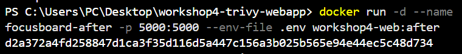


### 4.5 Renforcement du Dockerfile

D'autres mesures ont été appliquées :

- Désactivation du mode debug de Flask (`debug=False`).
- Ajout d'un `HEALTHCHECK` pour vérifier l'état de l'application.
- Utilisation de `COPY --chown` pour adapter les permissions.
- Ajout d'un fichier `.dockerignore` pour exclure les fichiers inutiles ou sensibles, notamment `.env`, `config.py`, `.git` et les fichiers temporaires.

Le Dockerfile final utilise notamment :

```dockerfile
ENV PYTHONDONTWRITEBYTECODE=1
ENV PYTHONUNBUFFERED=1
ENV FLASK_DEBUG=0
```

Et le contrôle de santé :

```dockerfile
HEALTHCHECK --interval=30s --timeout=5s --start-period=5s --retries=3 \
    CMD python -c "import urllib.request; urllib.request.urlopen('http://127.0.0.1:5000/api/health', timeout=3)" || exit 1
```

## 5. Vérification après remédiation

### 5.1 Construction de la nouvelle image

```powershell
docker build -t workshop4-web:after .
```
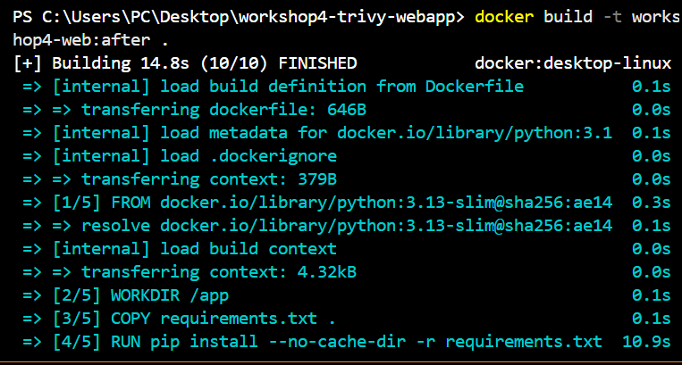

### 5.2 Vérification de la compilation

La compilation Python a été vérifiée dans le conteneur :

```powershell
docker run --rm --env-file .env workshop4-web:after python -m compileall -q app.py
```

Aucune erreur de compilation n'a été détectée.
      

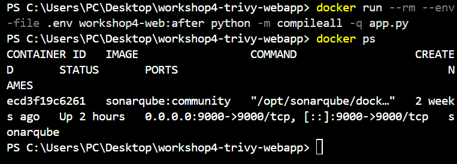

### 5.3 Vérification du fonctionnement

Le conteneur a été lancé avec :

```powershell
docker run -d --name focusboard-after -p 5000:5000 --env-file .env workshop4-web:after
```

Puis son état a été vérifié :

```powershell
docker ps
```

Le conteneur `focusboard-after` était en état **healthy** et l'application était accessible sur `http://localhost:5000`.


---
---
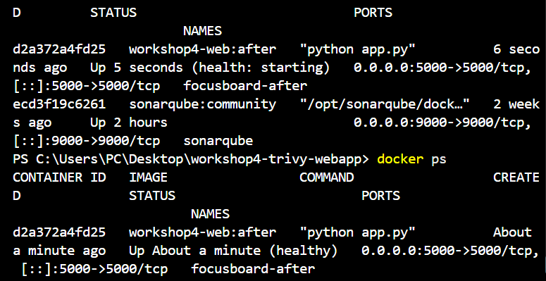

### 5.4 Nouveau scan Trivy

La nouvelle image a été analysée :

```powershell
docker run --rm -v /var/run/docker.sock:/var/run/docker.sock aquasec/trivy:latest image --severity HIGH,CRITICAL workshop4-web:after
```

Résultats obtenus :

| Composant | Après remédiation |
|---|---:|
| Vulnérabilités Debian HIGH | 45 |
| Vulnérabilités Debian CRITICAL | 0 |
| Vulnérabilités Python HIGH | 0 |
| Vulnérabilités Python CRITICAL | 0 |

Les 45 vulnérabilités HIGH restantes concernent des paquets système Debian. Le rapport Trivy ne fournit pas de version corrective pour les résultats affichés.

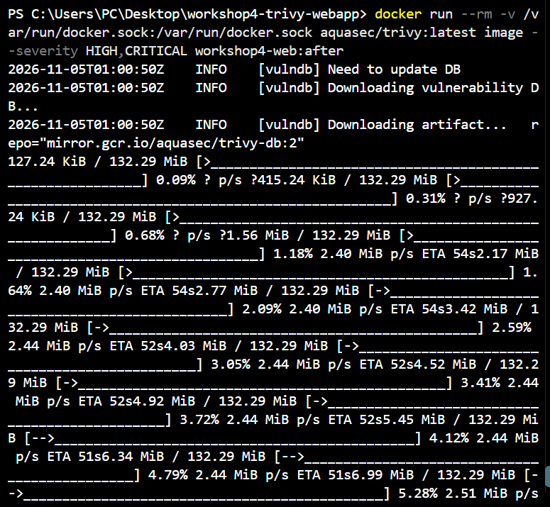

### 5.5 Nouveau scan de configuration

La configuration finale a été analysée une nouvelle fois :

```powershell
docker run --rm -v "${PWD}:/project" aquasec/trivy:latest config /project
```

Résultat :

```text
Target: Dockerfile
Misconfigurations: 0
```

Les trois mauvaises configurations détectées initialement ont donc été corrigées.

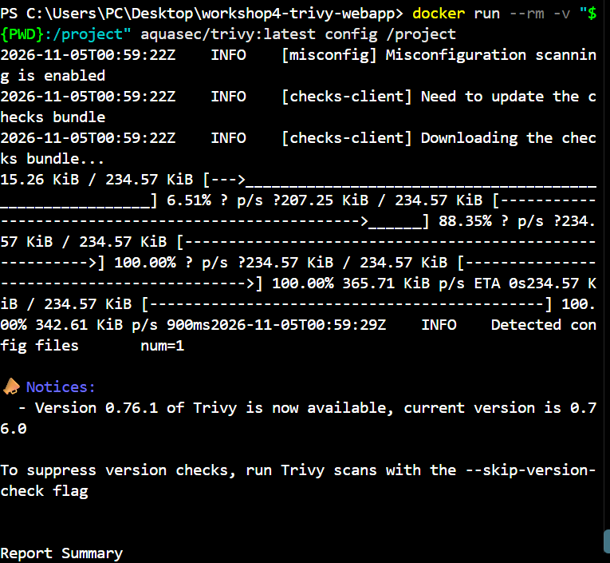
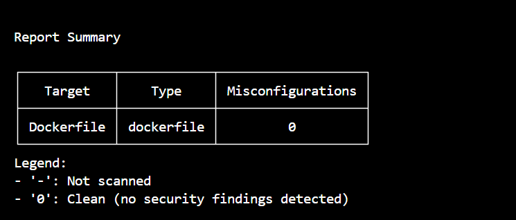

## 6. Intégration de Trivy dans GitHub Actions (CI/CD)

Un workflow GitHub Actions a été ajouté dans :

`.github/workflows/trivy.yml`

Ce pipeline se déclenche automatiquement lors d'un `push` ou d'une `pull_request` ciblant la branche `workshop4-Groupe10`.

Il contient trois contrôles :

1. **Scan de l'image Docker :** recherche des vulnérabilités HIGH et CRITICAL dans les paquets système et les bibliothèques.
2. **Scan de configuration :** vérification du Dockerfile avec Trivy.
3. **Scan des secrets :** recherche de secrets exposés dans les fichiers du dépôt.

### Politique de blocage

Le paramètre suivant est utilisé pour le scan de l'image :

```yaml
severity: HIGH,CRITICAL
ignore-unfixed: true
exit-code: '1'
```

Cela signifie que le pipeline échoue lorsqu'une vulnérabilité HIGH ou CRITICAL disposant d'un correctif est détectée.

Pour les scans de configuration et de secrets, `exit-code: '1'` permet également de bloquer le pipeline en cas de détection.

Les étapes de configuration et de recherche des secrets utilisent `if: always()` afin de s'exécuter même si le scan de l'image échoue.

### Résultat du pipeline

Après les modifications et leur envoi sur GitHub, le workflow **Docker Security Scan with Trivy** a été exécuté avec succès.

**Statut final : SUCCESS**

Le pipeline a donc terminé ses contrôles sans erreur bloquante.

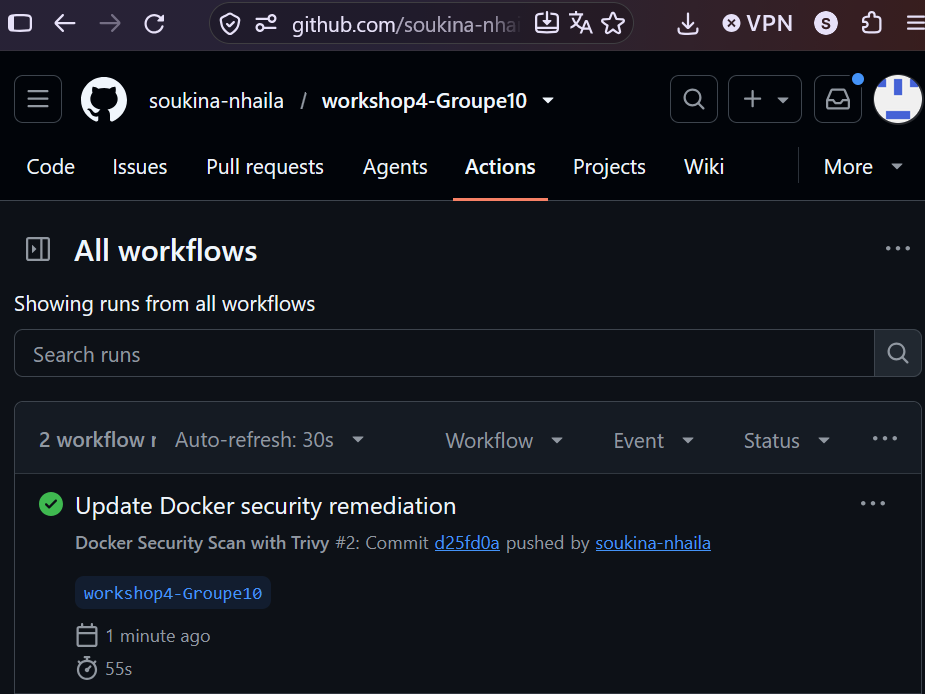

## 7. Bilan du workshop

Ce workshop a permis de mettre en pratique l'utilisation de Trivy pour sécuriser une image Docker.

Les principales améliorations réalisées sont :

- Mise à jour de l'image de base Python.
- Mise à jour et réduction des dépendances Python.
- Suppression de pip de l'image finale.
- Suppression des secrets codés en dur.
- Exclusion des fichiers sensibles avec `.gitignore` et `.dockerignore`.
- Exécution du conteneur avec un utilisateur non-root.
- Désactivation du mode debug.
- Ajout d'un HEALTHCHECK.
- Correction des mauvaises configurations Dockerfile.
- Vérification de la compilation et du fonctionnement de l'application.
- Intégration des scans Trivy dans GitHub Actions avec une politique de blocage.

**Conclusion :** le niveau de sécurité de l'image Docker a été amélioré. Les vulnérabilités HIGH et CRITICAL des dépendances Python ont été éliminées dans le scan final, les mauvaises configurations du Dockerfile ont été corrigées et le pipeline CI/CD fonctionne avec succès. Les vulnérabilités HIGH restantes dans les paquets Debian sont documentées et devront être surveillées lors des prochaines mises à jour.
